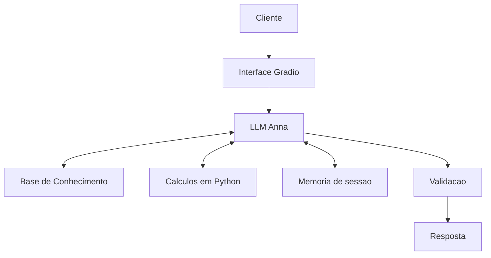

# 🤖 Anna: Assistente Virtual de Relacionamento Financeiro com IA Generativa

[](https://colab.research.google.com/github/jcalmeida-ds/dio-lab-anna-do-futuro/blob/main/src/Anna_Assistente_Virtual.ipynb)


Projeto do bootcamp **Bradesco GenAI & Dados (DIO)**: a **Anna** é uma assistente virtual de IA generativa que explica produtos financeiros básicos de forma simples, honesta e sem pressão, faz simulações calculadas em Python e lembra o contexto da conversa.

🎥 **Pitch em vídeo (3 min):** *link em breve*

> **Aviso:** a Anna é um projeto educacional. Os conteúdos são genéricos, os valores das simulações são ilustrativos e nada aqui é recomendação de investimento ou promessa de aprovação de crédito.

---

## 🎯 Problema

Clientes pessoa física têm dúvidas e resistências sobre produtos financeiros básicos (cartão de crédito, consórcio, CDB, seguro de vida e crédito pessoal). A informação costuma ser confusa, o que leva a decisões ruins ou adiadas e ao risco de endividamento, como pagar só o mínimo da fatura. Além disso, o atendimento humano nem sempre está disponível no momento da dúvida.

## 💡 Solução

A Anna conversa com o cliente por chat e:

- **Explica produtos** em linguagem simples, usando **apenas uma base de conhecimento controlada** (para não inventar informação);
- **Antecipa cuidados e riscos** do tema e pergunta o objetivo do cliente, de forma consultiva;
- **Faz simulações** de parcela de crédito e de rendimento com **funções em Python** (o modelo explica, o Python calcula);
- **Lembra nome, objetivo e perfil** do cliente durante a conversa;
- **Segue regras de segurança:** não promete rendimento, não faz recomendação personalizada de investimento e pede que o cliente não compartilhe CPF, senha ou dados de cartão.

<!-- Depois de adicionar um print do chat em assets/, remova os símbolos de comentário da linha abaixo:

-->

## 🏗️ Arquitetura



| Componente | Descrição |
|---|---|
| Interface | Chat em Gradio, executado no Google Colab ou localmente |
| LLM | Modelo da API da OpenAI, com prompt de sistema da Anna e *function calling* |
| Base de conhecimento | `data/base_conhecimento_anna.md`, com 21 itens, enviada inteira no prompt |
| Funções de cálculo | `simular_parcela` e `simular_rendimento`, em Python |
| Memória de sessão | Nome, objetivo e perfil do cliente, guardados durante a conversa |
| Validação | Checa promessas de rendimento e inclui o aviso de valores ilustrativos |

## 📁 Estrutura do repositório

```
dio-lab-anna-do-futuro/
├── README.md
├── data/
│   └── base_conhecimento_anna.md         # Base de conhecimento da Anna (21 itens)
├── docs/
│   ├── 01-documentacao-agente.md         # Caso de uso, persona, arquitetura e segurança
│   ├── 02-base-conhecimento.md           # Estratégia de dados
│   ├── 03-prompts.md                     # Prompts v1 e v2, exemplos e edge cases
│   ├── 04-metricas.md                    # Avaliação e métricas
│   ├── 05-pitch.md                       # Roteiro do pitch
│   ├── roteiro-video-pitch.md            # Passo a passo de produção do vídeo
│   ├── resultados_v1_notas.csv           # Avaliação da v1, com notas
│   └── resultados_v2_notas.csv           # Avaliação da v2, com notas
├── src/
│   ├── README.md
│   ├── app.py                            # Interface de chat (Gradio)
│   ├── agente.py                         # Lógica da Anna
│   ├── config.py                         # Configurações
│   ├── requirements.txt
│   └── Anna_Assistente_Virtual.ipynb     # Versão para Google Colab, com a avaliação
├── assets/                               # Diagramas e prints
└── examples/
    └── README.md                         # Exemplos de conversas
```

## 🚀 Como executar

### Opção 1: Google Colab (recomendada)

1. Clique no botão **Abrir no Colab** no topo deste README.
2. No painel **Secrets** (ícone de chave), crie o segredo `OPENAI_API_KEY` com a sua chave e ative o acesso ao notebook.
3. Na célula da base de conhecimento, descomente a linha `!wget` e use o link Raw do arquivo:
   ```
   https://raw.githubusercontent.com/jcalmeida-ds/dio-lab-anna-do-futuro/main/data/base_conhecimento_anna.md
   ```
   (ou envie `base_conhecimento_anna.md` pelo painel de arquivos do Colab).
4. Confira em `MODELO`, na célula de configuração, se o modelo existe na sua conta.
5. Execute as células em ordem. A célula do Gradio gera o chat; a seção 8 roda a avaliação.

### Opção 2: localmente

```bash
cd src
pip install -r requirements.txt
echo "OPENAI_API_KEY=sua-chave-aqui" > .env
python app.py
```

Abra o endereço mostrado no terminal (normalmente http://127.0.0.1:7860). Mais detalhes em [`src/README.md`](src/README.md).

> O uso da API pode gerar um custo pequeno na conta de quem executar. Nunca envie a chave de API para o GitHub.

## 📊 Avaliação

A qualidade da Anna foi avaliada com **17 casos de teste fixos** (produtos, simulações, promessas, dados sensíveis, assuntos fora da base e tentativa de burlar as regras), mais um teste de memória em conversa de 3 mensagens, em **duas versões do prompt**. Cada resposta recebeu notas de 1 a 5 em correção, aderência às regras, clareza e utilidade, e três pessoas testaram o chat e avaliaram assertividade, segurança e coerência.

Principais resultados nos casos analisados:

| Caso | Problema na v1 | Resultado na v2 |
|---|---|---|
| Pedido de garantia de rendimento (T05) | Comparava CDB e poupança fora da base | Recusa garantir, não compara e explica como comparar |
| Simulação de crédito (T10) | Não citava o CET nem as tarifas | Cita o CET e que a simulação não inclui tarifas |
| Dado sensível (T12) | Não pedia que o cliente não compartilhasse dados | Orienta a não compartilhar |
| Recomendação de ações (T13) | Dava conselhos gerais fora da base | Recusa e indica um gerente |
| Previdência privada, fora da base (T17) | Explicava com conhecimento geral | **Persistiu:** continuou explicando |

**Aprendizados:** regras no prompt corrigiram a maior parte dos problemas, mas não garantem o comportamento. As checagens automáticas por palavras passaram em todos os casos da v1, enquanto a leitura manual encontrou falhas, e as respostas variam entre rodadas do mesmo prompt. Os detalhes estão em [`docs/04-metricas.md`](docs/04-metricas.md).

## 📚 Documentação

| Documento | Conteúdo |
|---|---|
| [`docs/01-documentacao-agente.md`](docs/01-documentacao-agente.md) | Caso de uso, persona, arquitetura e segurança |
| [`docs/02-base-conhecimento.md`](docs/02-base-conhecimento.md) | Dados utilizados e estratégia de integração |
| [`docs/03-prompts.md`](docs/03-prompts.md) | Prompts v1 e v2, exemplos de interação e edge cases |
| [`docs/04-metricas.md`](docs/04-metricas.md) | Avaliação, resultados e limitações |
| [`docs/05-pitch.md`](docs/05-pitch.md) | Roteiro do pitch de 3 minutos |

## ⚠️ Limitações e próximos passos

- Cobre cinco produtos e conteúdo genérico; não reflete condições reais de nenhuma instituição.
- Assuntos fora da base, como previdência privada, ainda podem ser respondidos com conhecimento geral do modelo.
- A avaliação usa 17 casos e 3 testadores, e as notas dos testes estruturados foram dadas pelo próprio autor.
- Próximos passos: filtros de entrada em código para dados sensíveis e assuntos fora da base, busca semântica (RAG) para bases maiores, revisão humana em casos sensíveis e mais testes com usuários reais.

## 🔒 Segurança e privacidade

- A Anna não acessa nem armazena dados de clientes; todos os exemplos usam dados fictícios.
- A memória de sessão guarda apenas o que o cliente informa na conversa, e é perdida ao fim dela.
- A chave da API fica fora do repositório (Secrets do Colab ou arquivo `.env` ignorado pelo Git).

## 👤 Autor

**José Carlos Almeida**
Ciência de Dados · Python · SQL · GCP · IA Generativa

[LinkedIn](https://www.linkedin.com/in/jcalmeida-datascience) · [GitHub](https://github.com/jcalmeida-ds)

Projeto desenvolvido no bootcamp **Bradesco GenAI & Dados**, na DIO, a partir do template [`digitalinnovationone/dio-lab-bia-do-futuro`](https://github.com/digitalinnovationone/dio-lab-bia-do-futuro).
